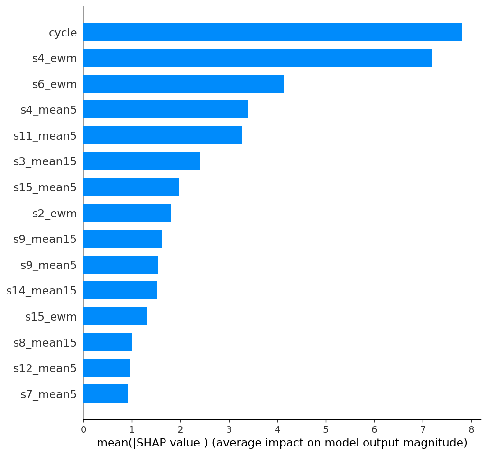

# ✈️ Predictive Maintenance – Remaining Useful Life (NASA C-MAPSS)

Predicts how many operating cycles a turbofan engine has left before failure, explains every prediction with SHAP, and shows fleet health in an interactive Streamlit dashboard.


## Highlights
- **4 datasets** (FD001–FD004), single and multiple operating regimes / fault modes.
- **7 models**: Linear baseline, Random Forest, XGBoost, LightGBM, LSTM, 1D-CNN.
- **Leak-free pipeline**: all fitting on train only, per-engine rolling features, validation split **by engine**.
- **Explainable**: global + per-engine SHAP.
- **Dashboard**: fleet status (🟢 / 🟡 / 🔴), predicted RUL, health index over time, sensor trends, SHAP per engine.

## Pipeline
1. **Target**: `RUL = last_cycle − cycle`, clipped at 125 (piece-wise linear RUL).
2. **Preprocessing**: KMeans on operating settings (6 regimes for FD002/FD004) → per-regime sensor standardisation; constant sensors dropped.
3. **Features** (per engine, past data only): rolling mean (5, 15), rolling std (5), EWM, first difference, cycle count (~100 features).
4. **Models**: tree models on engineered features; LSTM / 1D-CNN on 30-cycle sliding windows.
5. **Validation**: `GroupKFold` by engine for trees, 15 % held-out engines for deep learning. **Test**: last reading of each test engine vs. the official RUL file.
6. **Metrics**: MAE, RMSE, NASA scoring function (late predictions are penalised more than early ones).

## Results

Test set, last cycle per engine. **Main metrics are computed against RUL clipped at 125**, the same cap used for training. The *official* RMSE (against the unclipped RUL file) is shown for reference.

### Best tree model vs. best deep model

| Dataset | Model | MAE | RMSE | NASA score | RMSE (official) |
|---|---|---|---|---|---|
| FD001 | XGBoost | 12.03 | 15.85 | **384** | 17.11 |
| FD001 | 1D-CNN | **10.90** | **14.88** | 430 | **16.15** |
| FD002 | RandomForest | 11.42 | 15.42 | 1193 | 27.36 |
| FD002 | LSTM | **10.71** | **14.32** | **1062** | **27.30** |
| FD003 | LightGBM | 12.22 | 16.95 | 559 | 18.56 |
| FD003 | LSTM | **9.30** | **13.24** | **341** | **14.73** |
| FD004 | XGBoost | 11.84 | 16.96 | **1662** | 28.05 |
| FD004 | LSTM | **11.00** | **15.88** | 1716 | **26.97** |

### All tree models (capped metrics)

| Dataset | Model | MAE | RMSE | NASA score |
|---|---|---|---|---|
| FD001 | Linear | 14.56 | 19.32 | 759 |
| FD001 | RandomForest | 12.45 | 16.85 | 461 |
| FD001 | XGBoost | 12.03 | 15.85 | 384 |
| FD001 | LightGBM | 12.20 | 16.69 | 434 |
| FD002 | Linear | 14.52 | 17.82 | 1389 |
| FD002 | RandomForest | 11.42 | 15.42 | 1193 |
| FD002 | XGBoost | 11.33 | 15.45 | 1146 |
| FD002 | LightGBM | 11.56 | 15.53 | 1112 |
| FD003 | Linear | 15.19 | 19.37 | 1020 |
| FD003 | RandomForest | 13.03 | 17.58 | 602 |
| FD003 | XGBoost | 12.54 | 17.23 | 619 |
| FD003 | LightGBM | 12.22 | 16.95 | 559 |
| FD004 | Linear | 16.82 | 21.14 | 2453 |
| FD004 | RandomForest | 12.46 | 17.42 | 1689 |
| FD004 | XGBoost | 11.84 | 16.96 | 1662 |
| FD004 | LightGBM | 11.92 | 17.01 | 1545 |

### Deep models (capped metrics)

| Dataset | Model | MAE | RMSE | NASA score |
|---|---|---|---|---|
| FD001 | LSTM | 11.27 | 15.13 | 475 |
| FD001 | 1D-CNN | 10.90 | 14.88 | 430 |
| FD002 | LSTM | 10.71 | 14.32 | 1062 |
| FD002 | 1D-CNN | 11.12 | 15.30 | 1263 |
| FD003 | LSTM | 9.30 | 13.24 | 341 |
| FD004 | LSTM | 11.00 | 15.88 | 1716 |
| FD004 | 1D-CNN | 12.71 | 17.58 | 1628 |

### Notes
- **Why the official RMSE looks much worse on FD002/FD004** (≈27–28): the models are trained on RUL capped at 125, but the official test RUL is not capped, and 57 of 259 (FD002) and 67 of 248 (FD004) test engines have a true RUL above 125. That gap is a metric artefact, not model failure.
- Deep models clearly help on **FD003** (RMSE 16.95 → 13.24). On **FD002/FD004** the gain is only about 1 cycle.
- The 1D-CNN **overfits** on FD002/FD004 (validation error rises after the first epochs) and is not better than the trees there.
- All deep-learning numbers come from a **single run with one seed**; differences of about 1 cycle may be noise.
- Tree CV RMSE and deep-model validation RMSE are measured on different splits and are not directly comparable.

## Explainability
SHAP shows which sensors drive the predictions (e.g. `s4`, `s11`, `s6`, `s3` and the cycle count dominate on FD001).



## Quick start (PowerShell)
```powershell
python -m pip install -r requirements.txt
python -m src.download_data
python -m src.train --fd ALL
python -m src.explain --fd FD001 --unit 34
python -m src.train_dl --fd FD001 --model lstm      # or cnn, FD001..FD004
python -m streamlit run app.py
```

## Project structure
```
src/
  config.py          constants (RUL cap, thresholds, paths)
  download_data.py   fetch C-MAPSS files
  data.py            loading + RUL target
  preprocessing.py   regime normalisation + rolling features
  metrics.py         MAE, RMSE, NASA score (+ capped variants)
  train.py           tree models, GroupKFold, test evaluation
  train_dl.py        LSTM / 1D-CNN on sliding windows
  explain.py         SHAP (global + per engine)
app.py               Streamlit dashboard
reports/             result tables and plots
```

## Dataset
NASA C-MAPSS Turbofan Engine Degradation Simulation (Saxena & Goebel, 2008). The data files are not stored in this repo; `python -m src.download_data` downloads them.

## Possible next steps
Multiple seeds with confidence intervals, hyper-parameter search, attention/Transformer models, a RUL-uncertainty estimate, and Docker deployment.
